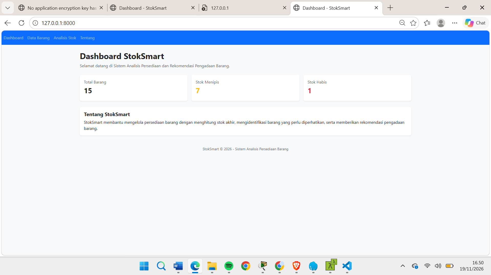
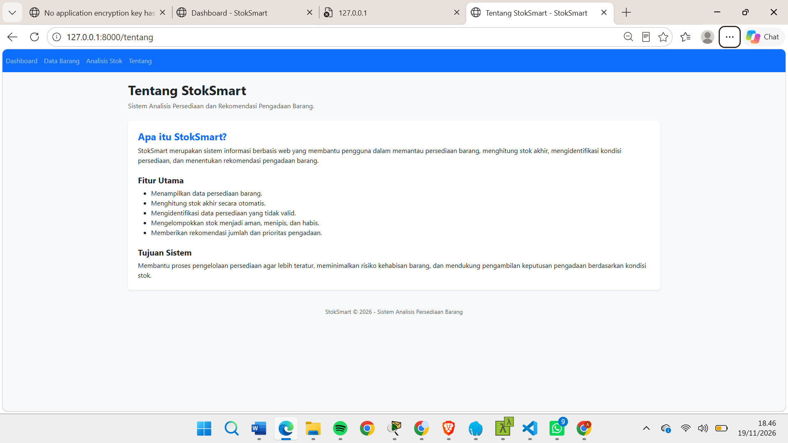

# StokSmart
## Sistem Analisis Persediaan dan Rekomendasi Pengadaan Barang

### Identitas Mahasiswa
- **Nama:** Deva Sayyidatul Adawiyah
- **NIM:** C2483207001
- **Kelas:** PTI5A

### Deskripsi Proyek
StokSmart merupakan sistem yang dibuat untuk membantu pengelola usaha dalam memantau persediaan barang. Permasalahan yang diangkat adalah kesulitan mengetahui kondisi stok barang, terutama barang yang hampir habis atau sudah habis, sehingga pengadaan barang terkadang tidak dilakukan tepat waktu.

Sistem ini membantu menganalisis persediaan, mengelompokkan kondisi stok, serta memberikan rekomendasi jumlah barang yang perlu diadakan kembali.

### Fitur Sistem
- Menampilkan ringkasan persediaan barang.
- Menampilkan daftar barang berdasarkan kategori.
- Menampilkan detail setiap barang.
- Menghitung stok akhir barang.
- Mengidentifikasi data persediaan yang tidak valid.
- Mengelompokkan stok menjadi Aman, Menipis, dan Habis.
- Menghitung kebutuhan pengadaan barang.
- Menampilkan prioritas pengadaan barang.

### Implementasi MVC
**1. Routing**

Menggunakan route untuk menghubungkan alamat URL dengan Controller atau halaman yang dituju. Sistem memiliki 7 route utama, yaitu Dashboard, Data Barang, Detail Barang, Analisis, Tentang, Kategori, dan Informasi.

**2. Controller**

Controller digunakan untuk mengolah data dan menjalankan logika sistem:
- `DashboardController` untuk mengolah ringkasan persediaan.
- `BarangController` untuk mengelola data barang dan perhitungan stok.
- `AnalisisController` untuk mengolah hasil analisis dan rekomendasi pengadaan.

**3. Blade View**

Blade View digunakan untuk menampilkan antarmuka aplikasi, yaitu:
- Dashboard
- Daftar Barang
- Detail Barang
- Analisis Persediaan
- Tentang
- Layout utama

### Logika Perhitungan Persediaan

**1. Menghitung Stok Akhir**

Stok Akhir = Stok Awal + Barang Masuk - Barang Keluar

**2. Validasi Data**

Data dinyatakan tidak valid apabila nilai stok negatif atau jumlah barang keluar melebihi jumlah stok awal ditambah barang masuk.

**3. Klasifikasi Kondisi Stok**
- Aman: stok akhir lebih dari 50% stok target.
- Menipis: stok akhir tidak lebih dari 50% stok target.
- Habis: stok akhir bernilai 0.

**4. Rekomendasi Pengadaan**

Kebutuhan Pengadaan = Stok Target - Stok Akhir.

Jika hasilnya kurang dari 0, kebutuhan pengadaan ditetapkan menjadi 0.

**5. Prioritas Pengadaan**
- Tinggi: barang dengan kondisi stok habis.
- Sedang: barang dengan kondisi stok menipis.
- Rendah: barang dengan kondisi stok aman.

### Teknologi yang Digunakan
- PHP
- Laravel
- HTML
- CSS
- Bootstrap
- Blade Template

Data barang disimpan menggunakan array PHP tanpa menggunakan database.

### Screenshot Aplikasi

**1. Dashboard**



**2. Data Barang**


**3. Detail Barang**


**4. Analisis Persediaan**


**5. Data Tidak Valid**


**6. Halaman Tentang**



**7. Route List**


### Cara Menjalankan Aplikasi

1. Clone repository ini.
2. Masuk ke folder project.
3. Jalankan perintah:

```bash
composer install
```

4. Salin file `.env.example` menjadi `.env`.
5. Jalankan perintah:

```bash
php artisan key:generate
```

6. Jalankan aplikasi:

```bash
php artisan serve
```

7. Buka browser dan akses:

```text
http://127.0.0.1:8000
```

---

**StokSmart — Sistem Analisis Persediaan dan Rekomendasi Pengadaan Barang**
